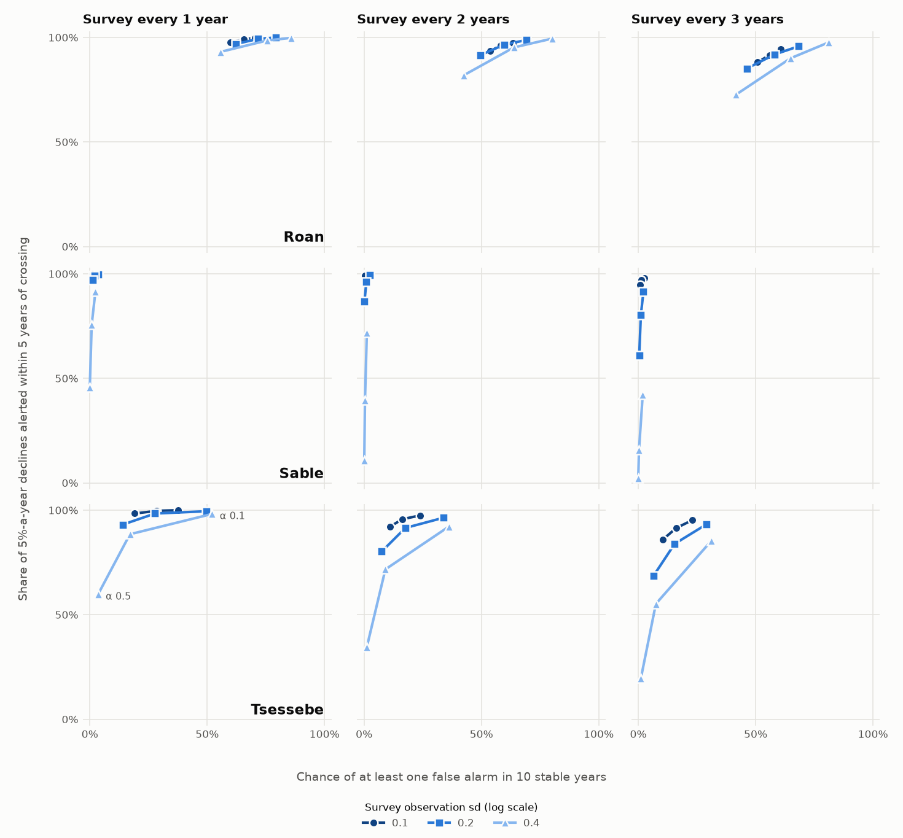
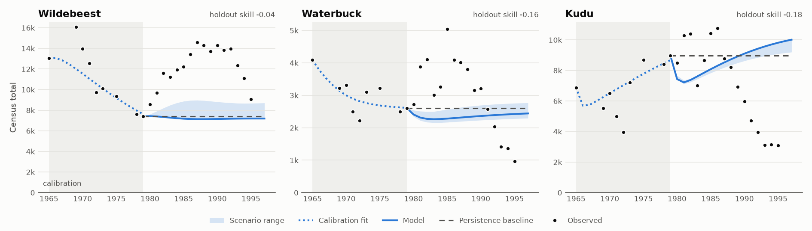

# Population Model
[](https://github.com/benmacp123/population-model/actions/workflows/main.yml)

Two attempts to forecast Kruger National Park herbivore counts, each scored
against rules fixed in advance, failed to beat naive baselines. That is the
usual result for short, noisy population series: in a comparison of 49
methods the single best forecast was the most recent observation (Ward et
al. 2014, *Oikos* 123: 652-661), and in the NEON phenology forecasting
challenge a historical-mean null beat every submitted model (Wheeler et al.
2024, *Agricultural and Forest Meteorology*). So the project's third version
treats that noise as the subject. Instead of forecasting counts, it asks how
quickly and how reliably a threshold alert would catch a real decline in
Kruger's rare antelope, how often the alert would fire when nothing is
wrong, and what more frequent or more precise surveys would buy.

The alert is judged the way a protection relay is set: on dependability
(does it trip on a real fault?), security (does it stay quiet otherwise?)
and speed. Kruger already manages by thresholds of potential concern; the
park's review of them in river management reported staff doubts that
sampling was frequent enough to detect trends, and a risk that too many
flags would overload the process (McLoughlin et al. 2011, *Koedoe* 53(2)).

## Version 3: how reliable is a decline alert?

**Status: design sweep and retrospective replay complete.** `make
results-v3` reproduces every output in `results/v3/` byte for byte in
about 25 seconds.

### Design

- **Species:** roan, sable and tsessebe, whose 1986-1997 crashes are the
  declines a Kruger threshold existed to catch.
- **Operating model:** the version 2 state-space model without rainfall,
  fitted to the 1969-1985 regional counts. *Labelled assumption:* 1985 was
  chosen knowing the declines began after 1986, so the window means
  "behaviour before the crash". Process and survey noise are not separately
  identified, so the fitted total is split 25/75, 50/50 and 75/25 between
  them and each split is simulated.
- **Alert:** in each survey year, alert if the filtered probability that
  the core-region index is more than 30% below baseline exceeds alpha
  (0.1, 0.25 or 0.5). Thirty per cent is the IUCN Criterion A Vulnerable
  magnitude, a provisional choice: no published numeric Kruger threshold
  for these species was found. Fifty per cent is run as a sensitivity.
- **Survey designs:** every 1, 2 or 3 years, with observation sd 0.1, 0.2
  or 0.4 on the log scale (about 10-40% CV, inside the 3-71% range reported
  for helicopter counts by Reilly 2002, *Koedoe*).
- **Scenarios:** stable; true declines of 3, 5 and 10% a year; and
  detection drift, where counts miss 3% more animals each year but the
  population does not change. 1000 simulated 25-year runs per cell.

Nothing in the sweep is scored against real counts. The real 1986-1997
counts are used only in the replay below, with its rule fixed beforehand.

### Design sweep



Each line is one survey precision; its three points are alpha 0.1, 0.25
and 0.5, moving from the upper right (sensitive, noisy) to the lower left
(quiet, slower). The ideal is the top-left corner. Panels show the 50/50
noise split and the 30% threshold.

| Species | Survey | Obs. sd | False alarm in 10 stable years | 5%-a-year declines missed | Median delay (years) | Alarm from 3%-a-year detection drift |
|---|---|---|---|---|---|---|
| Roan | annual | 0.1 | 66% | 1% | 0 | 83% |
| Roan | annual | 0.4 | 76% | 1% | 0 | 87% |
| Roan | every 3 years | 0.1 | 56% | 8% | 0 | 75% |
| Roan | every 3 years | 0.4 | 65% | 10% | 0 | 79% |
| Sable | annual | 0.1 | 2% | 0% | 0 | 35% |
| Sable | annual | 0.4 | 1% | 24% | 4 | 9% |
| Sable | every 3 years | 0.1 | 1% | 3% | 2 | 30% |
| Sable | every 3 years | 0.4 | 0% | 84% | 6 | 2% |
| Tsessebe | annual | 0.1 | 29% | 0% | 0 | 82% |
| Tsessebe | annual | 0.4 | 17% | 12% | 1 | 59% |
| Tsessebe | every 3 years | 0.1 | 16% | 9% | 1 | 62% |
| Tsessebe | every 3 years | 0.4 | 8% | 45% | 4 | 26% |

Alpha 0.25 and the 50/50 noise split. A decline is missed if no alert
comes within 5 years of the true index crossing the threshold; delay is
counted from that crossing and excludes missed runs, which is why the
figure plots the miss rate instead. All 19,440 result rows are in
`results/v3/survey_design.csv`.

What the sweep shows:

1. **The alert's probability is calibrated only when nothing is
   happening.** With a stable population and the model correct, cases
   given a crossing probability of p were below the threshold about p of
   the time for all three species (largest bin gap 0.040-0.050, inside
   the pre-set 0.05 tolerance). During real declines or detection drift they were not
   (largest gaps 0.07 roan, 0.24-0.45 tsessebe, 0.43-0.73 sable). The
   filter expects the population to drift back to its baseline, so it
   understates the chance that a decline has already crossed: for sable,
   cases given 0.1-0.2 were below the threshold 58% of the time.
2. **For roan, a 30% threshold sits inside natural fluctuation.** Roan's
   fitted year-to-year variance is 18 times sable's. Even with annual
   precise surveys, a stable roan population raises at least one false
   alarm in 10 years in more than half of runs. Its declines are rarely
   missed only because the alert fires so often anyway. The threshold, not
   the survey, is the problem.
3. **For sable and tsessebe, survey precision matters more than
   frequency.** Moving sable from sd 0.1 to 0.4 raises missed declines
   from 0% to 24% with annual surveys, and from 3% to 84% with surveys
   every three years. Surveying more often with a noisy method does less
   than surveying with a precise one.
4. **A count that slowly misses more animals looks the same as a
   decline.** A 3% a year detection drift, with no real change, raised an
   alarm within 10 years in 75-87% of roan runs and up to 82% of tsessebe
   runs in the table above. For sable and tsessebe, more precise surveys
   make this worse, not better, because the alert trusts each count more. Only a check on
   detection itself, such as distance sampling or ground calibration, can
   tell the two apart.

### Retrospective replay, 1986-1997

The rule was fixed before the replay was run: choose the smallest alpha
whose false-alarm rate under the fitted model is at most 0.05 per annual
survey (falling back to 0.5 if none qualifies), filter the real counts year
by year using only counts available at the time, and compare the first
alert with a raw-count rule that fires when the observed core-region index
first falls below 70% of baseline. Giraffe, impala and zebra run through
the same rule as negative controls. The outcome was already known, so
this is descriptive, not a test.

| Species | Alpha | Filter alert | Raw-count alert |
|---|---|---|---|
| Roan | 0.5 | 1992 | 1988 |
| Sable | 0.1 | 1993 | 1993 |
| Tsessebe | 0.5 (rule not met; fallback) | 1992 | 1992 |
| Giraffe, impala, zebra | 0.1 | none | none |

- **Roan: the filtered alert fired four years after the raw count.** The
  raw index was 58% of baseline in 1988 and stayed below 70%; the filter's
  crossing probability rose through 0.12, 0.20, 0.35 and 0.48 and passed
  0.5 only in 1992, when the index was at 24%. Given roan's large natural
  fluctuation, holding off is what keeps its false alarms at 0.04 per
  survey; it is also finding 1 of the sweep, seen in real data.
- **Sable and tsessebe: the filter adds nothing.** Their fitted survey
  noise is near zero (sd 0.048 and 0.0025, both artefacts of the noise
  split being unidentified), so the filter trusts each count almost
  exactly and fires in the same year as the raw rule. For tsessebe this
  also makes the false-alarm rate about 0.10 at every alpha, so the
  alpha rule could not be met and the fallback was used.
- **The controls stayed quiet** under both rules.

`results/v3/replay_summary.csv` has the summary, `replay_years.csv` the
year-by-year probabilities and `replay_alpha.csv` the alpha selection.

### Limits

- **Circularity.** The operating model is fitted to the same short series
  whose monitoring it evaluates; results mean "if the park behaves like
  this fit". The noise-split sweep and a near-random-walk operating model
  (`operating_model = near_random_walk` in the CSV) bound this, but do not
  remove it.
- **The 1969-1979 sensitivity window is uninterpretable.** Only 1977-1979
  fall in the second survey era, so those fits are degenerate (roan's
  total variance 0.001). It is reported in the CSVs, not used.
- **Drift is measured, not estimated.** The sweep shows what drift would
  do to the alert; the real detection drift in Kruger's surveys is
  unknown.
- **Precision is anchored elsewhere.** The observation-sd axis rests on
  CVs from other reserves; per-species CVs for Kruger's post-1998 distance
  sampling were not found.
- **Two 1972 values look like recording errors** (sable Central 114,
  tsessebe Central 0). They fall in the baseline and are kept, because
  removing them would be a choice made after seeing the data.

## How the evaluation was kept honest

Each version's scoring was fixed before it was run, and SHA-256 hashes of
the code and inputs were recorded before each run. Git history shows when
files were committed, not when decisions were made; the hashes let a reader
confirm that the committed files are the ones that produced the results.

| Version | Fixed before scoring | Committed in | Result |
|---|---|---|---|
| 1 | Calibration 1965-1979, holdout 1980-1995, persistence and calibration-mean baselines (not formally pre-registered) | [`4fa1cf2`](https://github.com/benmacp123/population-model/commit/4fa1cf2) | No holdout skill; one later change made after seeing the holdout is documented below |
| 2 | Model, rainfall covariate, rolling origins, CRPS and coverage criteria, eight confirmation species never examined in development | [`81b5e22`](https://github.com/benmacp123/population-model/commit/81b5e22) (`src/state_space.py` SHA-256 `5820f0eb…`) | None of three criteria met |
| 3 sweep | Operating model, design grid, scenarios, metrics and the calibration rule | [`4e523f4`](https://github.com/benmacp123/population-model/commit/4e523f4) (`src/monitoring.py` `2f047c8b…`, `scripts/survey_design.py` `1ddbf97f…`) | Calibrated only when the model is true |
| 3 replay | Alpha rule, its fallback and the raw-count rule | [`96f1fd5`](https://github.com/benmacp123/population-model/commit/96f1fd5) (`scripts/replay.py` `010bdf68…` before the docstring rewording below) | Descriptive; see above |

The version 2 scoring script in `81b5e22` includes one fix made after the
confirmation run: its CRPS returned NaN for zero-width forecasts, which
affected 5 of 2000 baseline rows; the fixed script reproduces the summary
byte for byte.

Since those runs, docstrings in `src/monitoring.py`,
`scripts/survey_design.py`, `scripts/evaluate_state_space.py` and
`scripts/replay.py` have been reworded to remove references to a planning
file that is not published. No code changed: for the first three, `git diff`
against the commits above shows docstring lines only. `scripts/replay.py`
was first committed (in `96f1fd5`) after the rewording, so the hash recorded before its run
(`010bdf68…`) applies to the file with its two original docstring lines
restored.

## Version 2: pooled state-space model with rainfall (closed, negative)

A log-scale Gompertz state-space model, pooled across Kruger's four census
regions (about four times as many data points as the park totals, and free
of the totals' round-number infill), with lagged April-September rainfall
from CRU TS as a covariate. A Kalman filter separates survey noise from
population change and skips missing region-years without imputation. Life
history traits are not used. Wildebeest, waterbuck and kudu (already seen
in version 1) were used to build the pipeline; the eight other species
were run once, on the frozen pipeline, with rolling one-year-ahead
forecasts from origins 1979-1994.

Mean one-step CRPS on the log scale, 62-64 scored region-years per species
(lower is better):

| Species | Rain | No rain | Random walk | Rain skill vs random walk | Rain beats no rain | Rain 80% interval coverage |
|---|---|---|---|---|---|---|
| Eland | 0.441 | 0.433 | 0.420 | -0.050 | no | 0.73 |
| Giraffe | 0.107 | 0.103 | 0.107 | +0.002 | no | 0.71 |
| Impala | 0.160 | 0.162 | 0.149 | -0.068 | yes | 0.94 |
| Roan | 0.430 | 0.438 | 0.395 | -0.088 | yes | 0.66 |
| Sable | 0.135 | 0.152 | 0.146 | +0.078 | yes | 0.60 |
| Tsessebe | 0.363 | 0.383 | 0.381 | +0.049 | yes | 0.66 |
| Warthog | 0.289 | 0.288 | 0.228 | -0.267 | no | 0.65 |
| Zebra | 0.084 | 0.083 | 0.081 | -0.035 | no | 0.73 |

Against the criteria fixed in advance:

- Beat the random walk for at least 5 of 8 species: **not met** (3 of 8,
  one a tie).
- 80% interval coverage within 70-90%: **not met** for 5 of 8 species
  (mostly too narrow). The random walk's intervals were the best
  calibrated (0.79-0.92), which is why version 3 builds on its noise
  rather than on the rainfall model.
- Rainfall beats the same model without it for at least 5 of 8: **not
  met** (4 of 8).

A post hoc observation, not a test: rainfall helped sable, tsessebe, roan
and impala, consistent with published links between dry-season rain and
the rarer antelope, and cost no species more than 0.008 CRPS. The
differences are small and have no uncertainty estimate. Process and
observation noise are not separately identifiable at this series length,
so fitted parameters are not interpreted.

`make results-v2` reruns the development species; the confirmation run
is `PYTHONPATH=src python scripts/evaluate_state_space.py --confirmation`
and writes `results/v2_confirmation_*.csv`. Rainfall provenance and
licence (ODbL) are in [`data/README.md`](data/README.md).

## Version 1: two-stage population model (closed, negative)

A simple two-stage (juvenile/adult) population model for Kruger National Park herbivores, calibrated on 1965-1979 census totals and tested against the 1980-1995 counts it never saw (1996-1997 have no reported totals).

### Approach

The model is fitted on an early period of observed counts, restarted from the last calibration observation, projected forward year-by-year, and scored against the later observed counts. The gap between projected and observed is the point - a forecast on its own can't be checked, a backtest can. Every score is compared with two naive baselines, one carrying the last known count forward and one using the mean of the calibration-period counts, so "better than doing nothing" is measured rather than assumed.

### What version 1 does

The model runs end to end from committed data. It:

- keeps species traits and year-by-year counts as separate datasets
- derives `data/raw/species_traits.csv` from the committed PanTHERIA WR05 file
- normalises the SANParks 1965-1997 fixed-wing total-count series into
  `data/raw/species_counts.csv`, with a source citation on every row and
  missing totals left missing rather than zero
- applies birth, mortality and maturation dynamics with density dependence
- calibrates three bounded parameters per species on 1965-1979 and reports
  low/central/high scenarios from the near-best parameter sets
- scores the holdout on level and trend against persistence and
  calibration-mean baselines, and writes a results table and figure to `results/`
- exposes a single-species projection through a `click` CLI

The active species are wildebeest, waterbuck and kudu. Zebra is excluded
until its missing reproductive traits are sourced. The census series stops at
1997 because Kruger moved from total counts to distance sampling in 1998.

**Status: complete, result negative.** The model reproduces the
calibration period to within 11-13% but has no forecasting skill on the
holdout: it never meaningfully beats carrying the 1979 count forward, is
well behind simply using the 1965-1979 mean, and misses the 1980s rise and
1990s collapse. That finding holds across the stage split, sex ratio, grid
resolution, search bounds and restart rule; the exact per-species skill
values do not. See
[Results](#results). This is the model's honest finding, not a bug; the most
likely missing ingredient is rainfall.

### Results

`make results` reproduces the table and figure below
(`results/backtest_summary.csv`, `results/backtest.png`).



| Species | Calibration error | Holdout error | Persistence baseline | Skill | Step direction agreement | Observed inside scenario range |
|---|---|---|---|---|---|---|
| Wildebeest | 11.0% | 42.2% | 39.5% | -0.07 | 53% | 0% |
| Waterbuck | 10.6% | 33.9% | 33.5% | -0.01 | 67% | 6% |
| Kudu | 12.8% | 45.9% | 36.4% | -0.26 | 40% | 0% |

A second naive baseline, the mean of the reported 1965-1979 totals, is
harder to beat than persistence and uses no holdout data:

| Species | Calibration-mean baseline error | Model skill against it |
|---|---|---|
| Wildebeest | 15.4% | -1.73 |
| Waterbuck | 30.0% | -0.13 |
| Kudu | 34.0% | -0.35 |

Errors are mean absolute error as a percentage of the observed mean.
Skill is `1 - model error / baseline error`; above zero beats the baseline.
Scores cover the 16 reported holdout years, 1980-1995. The 1979 anchor
shared by the forecast and the persistence baseline is partly an estimate
(see [Data caveats](#data-caveats)).
Step direction agreement is the share of consecutive reported years where
the projection moves the same way as the census. The persistence baseline
never moves, so the model trivially beats it on direction; level skill is
the meaningful test.

Fitted parameters (central scenario). These are grid- and stage-split-specific
fitted values, not vital-rate estimates: halving the grid step moves them,
and changing the provisional juvenile fraction moves fitted juvenile
mortality between 0.25 and 0.60.

| Species | Juvenile mortality | Birth multiplier | Capacity (x calibration peak) | On search bound |
|---|---|---|---|---|
| Wildebeest | 0.40 | 0.9 | 0.5 | capacity (grid edge only) |
| Waterbuck | 0.40 | 0.6 | 0.9 | none |
| Kudu | 0.55 | 0.5 | 1.5 | birth, capacity |

What the results show:

1. **The model fits the past but cannot forecast it.** Fitted on 1965-1979,
   it settles towards an equilibrium below its capacity parameter. For
   wildebeest that equilibrium sits close to the 1979 anchor, so the
   projection is nearly flat and scores close to persistence by
   construction. The census instead rose sharply in the early
   1980s and then fell 38-81% from peak by 1995.
2. **The dynamics changed between periods.** As a diagnostic, fitting the
   same three parameters directly on 1980-1997 (`make holdout-ceiling`)
   beats persistence comfortably (skill 0.86 wildebeest, 0.31 waterbuck,
   0.42 kudu): the stage structure can overshoot capacity and fall back,
   following the 1980s rise and a gentle decline. But those parameters miss
   1965-1979 by 33-73%, and none reproduce the steep 1991-95 crash. No
   single parameter set describes both periods. A changing external driver
   is one explanation; three compensating parameters fitted to 8 noisy points
   would also transfer poorly, so this diagnostic does not separate the two.
   The diagnostic restarts from a 50/50 split in 1979 and has not been
   rerun with the carried stage share used by the forecast. Published Kruger
   work links these declines to rainfall and the 1991-92 drought (for
   example Ogutu & Owen-Smith 2003, *Ecology Letters* 6: 412-419), and the
   1970s were unusually wet. These diagnostic numbers are not forecast
   scores.
3. **The scenario range is too narrow.** Near-best parameter sets agree with
   each other, so the band almost never contains the observed counts. The
   uncertainty that matters here is structural, not parametric.
4. **Kudu fits on a search bound.** It needs the lowest birth rate and
   highest capacity allowed. Widening the capacity range to 0.3-3.0 improves
   its calibration error (12.8% to 12.6%) but worsens holdout skill (-0.26 to
   -0.38), a small illustration of overfitting. Wildebeest's lowest-capacity
   fit is a grid artefact: over the same wider range its optimum stays at an
   interior 0.5.
5. **The restart carries the model's own stage split.** The 1979 restart
   uses the observed total but splits it using each parameter set's own
   1979 juvenile share (0.56 wildebeest, 0.39 waterbuck, 0.24 kudu for the
   central fit), not the provisional 50/50 seed. An earlier version re-seeded
   50/50, which caused an artificial first-year kudu drop and moved skill by
   up to 0.15 (published then as -0.04, -0.16 and -0.18). The switch was made
   after those holdout results had been seen; it is a consistency fix, not a
   tuning choice, and it does not change the finding.

### Data caveats

- **Some totals include regional infill.** In 1970, 1978, 1979, 1994 and
  1995 the source `TOTAL` exceeds the sum of the regional counts by a round
  number, so unsurveyed regions were estimated. The 1979 anchor includes
  1200 of 7412 wildebeest (16%), 2500 of 8974 kudu (28%) and 450 of 2605
  waterbuck (17%) for the uncounted South region. 1965 has no regional
  breakdown for kudu or waterbuck.
- **The series spans more than one method.** The DataONE record describes
  1965-1976 as aerial totals corrected by ground counts and 1977-1997 as
  Ecological Aerial Survey totals; the KNB copy states park coverage was
  complete only in 1980-1993. The 1998 switch to distance sampling is a
  further break, which is why the series stops at 1997.
- **The calibration window was managed.** Wildebeest and zebra were culled
  in the late 1960s and early 1970s, and lions in 1974-75, so 1965-1979 is
  not unmanaged dynamics. These dates come from secondary sources.

### Data structure

Two inputs are held separately, matching how the data actually gets sourced:

| Dataset | Grain | Source in practice |
|---|---|---|
| Species traits | one row per species | PanTHERIA and other published literature |
| Species counts | one row per species per year | Kruger aerial census / survey data |

Traits are stable constants; counts vary year to year. Keeping them apart means each carries its own provenance, and it avoids duplicating the biology across every count row.

Three trait fields are optional overrides, left empty by default:

- `juv_death_rate` - falls back to the adult mortality rate
- `carrying_capacity` - falls back to the biomass proxy below
- `birth_multiplier` - falls back to 1 (one young per interbirth interval)

Where a real value is available from literature, set it in the traits table; no code change needed.

The traits table can be regenerated with `make build-traits`. Its provenance
and missing-value conventions are recorded in `data/README.md`.

### Model formulation

- **Carrying capacity** - explicit value where supplied, otherwise a biomass proxy from the start year:
  ```text
  K = (Σ_i N_i * w_i) / w_target
  ```
  where `N_i` is total population of species `i`, `w_i` its average weight, and `w_target` the target species' average weight.
  The calibrated evaluation instead uses `K = capacity_multiplier * peak 1965-1979 total`.

- **Births per year** (females only):
  ```text
  B = N_adult * (1 -  male_ratio) * r_birth * birth_multiplier
  r_birth = 365.25 / interbirth_interval_days   (fallback: 12 / gestation_period_months)
  ```

- **Mortality**:
  ```text
  d_adult = 1 / life_span_years
  d_juvenile = juv_death_rate  (falls back to d_adult)
  D_adult = N_adult * d_adult
  D_juvenile = N_juvenile * d_juvenile
  ```

- **Maturation from juveniles to adults**, sex-weighted, density-limited, and capped at surviving juveniles:
  ```text
  M = min(N_juvenile * r_mat * f(K, N), N_juvenile * (1 - d_juvenile))
  r_mat = (1 / m_male) * male_ratio + (1 / m_female) * (1 -  male_ratio)
  f(K, N) = max(0, 1 -  (N_adult + N_juvenile) / K)
  ```

- **Population update**, floored at zero:
  ```text
  N_adult'    = max(0, N_adult + M -  D_adult)
  N_juvenile' = max(0, N_juvenile + B -  D_juvenile -  M)
  ```

- **Calibration**: grid search over juvenile mortality 0.10-0.60, birth
  multiplier 0.5-1.0 and capacity multiplier 0.5-1.5, minimising mean
  absolute error on the 8 reported 1966-1979 totals (1969-1973, 1975, 1978
  and 1979). Parameter sets within 10% of
  the best error form the low/high scenario envelope. These bounds are a
  defensible search range, not sourced values.

### Known simplifications

Recorded openly rather than buried - these are the model's honest limits.

1. **Juvenile mortality is fitted, not sourced.** The trait-table fallback is the adult rate; the evaluation fits it within 0.10-0.60.
2. **Carrying capacity is circular.** Both the biomass proxy and the calibration-peak capacity are inferred from counted animals rather than habitat or forage.
3. **Birth rate has no seasonality or age structure.** One young per interbirth interval, scaled by a fitted multiplier. Species without an interval (tsessebe, warthog) fall back to `12 / gestation_months`; warthog also lacks a maturity age, so it cannot be run at all.
4. **Mortality is a flat annual hazard.** `1 / life_span_years` is not an age-structured survival curve, and PanTHERIA's lifespan is the maximum recorded longevity, so the 4-5% a year it gives probably understates field adult mortality. Newborns also face no mortality in the step they are born, and maturation is a constant yearly fraction rather than a delay.
5. **Density dependence applies only to maturation**, not to births or mortality.
6. **The adult/juvenile split is assumed, not observed.** Census totals have no stage breakdown, so every total is split 50/50 as a provisional placeholder until a literature-sourced stable stage proportion is selected. Override with `--juvenile_fraction`.
7. **Sex-specific maturity is copied from one value.** PanTHERIA gives a single sexual maturity age, which is used for both males and females.
8. **The male ratio is a 50/50 placeholder**, not a sourced value. Override with `--male_ratio`.
9. **No environmental drivers.** Rainfall, drought, predation, disease and management removals are absent, so the model cannot produce the observed boom-and-bust.

### Known issues

1. **No holdout skill** for any species (see [Results](#results)).
2. **The single-species CLI still uses the community-biomass proxy.** It treats
   all counted herbivore biomass as available to one species, giving
   capacities 8-30 times the observed peak, and silently drops species with no
   start-year total (buffalo in 1965). Use `make evaluate-model` for the
   calibrated model.
3. **Kudu fits on search bounds**, a sign of structural misfit (wildebeest's apparent bound is a grid artefact).

### What I would do next

The project is closed, but a review of the method identified what a second
iteration should change:

1. **Model observation error explicitly.** Single-year swings of +82% (kudu)
   and +55% (waterbuck) exceed what these species can biologically achieve,
   so much of the year-to-year variation is survey noise. A state-space
   model (density-dependent growth with separate process and observation
   error) separates the two - the same problem as state estimation with a
   Kalman filter in power-system monitoring.
2. **Use fewer, identifiable parameters.** PanTHERIA traits are
   species-level life history, not population vital rates, and three
   parameters fitted to 8 calibration points are poorly identified. A
   Gompertz or Ricker model with traits used only as a sanity check on the
   fitted growth rate is more defensible.
3. **Test forecasts more fairly.** One-step-ahead and rolling-origin
   forecasts give far more evaluation points than a single 15-year
   projection, plus a check that uncertainty bands cover the observations at
   their stated rate.
4. **Add rainfall as a covariate.** SANParks publishes Kruger rainfall
   (1911-2003) on the same DataONE portal as the census; published Kruger
   studies link these declines to rainfall.

Version 2 (above) did all four, using CRU TS rainfall rather than the
SANParks series, and still did not beat the random walk.

## Getting started

1. Install [uv](https://docs.astral.sh/uv/), then create the environment
   in `venv/` (uv fetches Python 3.14 if needed) and activate it:
   ```bash
   make install
   source venv/bin/activate
   ```
   Without uv, `pip install -r requirements.txt` into a Python 3.14
   virtual environment installs the same versions.
3. Reproduce the results:
   ```bash
   make results-v3   # version 3 design sweep, figure and replay
   make results-v2   # version 2 development species
   make results      # version 1 calibration, holdout scores and figure
   ```
4. Run a single-species version 1 projection:
   ```bash
   ./src/growth_model.py --species_name Wildebeest --start_year 1965 --forecast_horizon 6 --juv_death_rate 0.35
   ```
   `--start_year` must exist in the counts dataset for the chosen species, since the projection is initialised from observed values.
5. Run the tests, lint and formatting check:
   ```bash
   make test lint format-check
   ```

## Notes

- This repository is a research prototype, not a management tool.
- Data provenance for every committed file is recorded in [`data/README.md`](data/README.md).
- Dependencies are pinned once in `pyproject.toml` and the full tree is locked in `uv.lock`, so CI and local runs use the same versions; `requirements.txt` is exported from the lock (`make requirements`).

## Licence

Code, documentation and results are released under the MIT Licence; see
[`LICENSE`](LICENSE). Third-party data in `data/raw/` stays under its
source's terms, recorded in [`data/README.md`](data/README.md).
